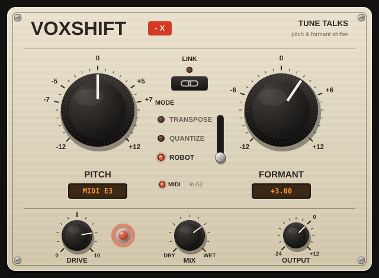

# VoxShift - X — by Tune Talks

Pitch & formant shifter monofonico per voci (VST3 / AU / Standalone), con tre modi (Transpose, Quantize, Robot), controllo via MIDI e saturazione valvolare.



## Controlli
| Controllo | Funzione |
|---|---|
| **PITCH** (±12 st) | Sposta l'intonazione senza cambiare il timbro. In Quantize e Robot si muove a semitoni interi. |
| **FORMANT** (±12 st) | Sposta le formanti senza cambiare la nota: valori positivi = voce più piccola/acuta, negativi = più grande/scura. |
| **LINK** | Il Formant segue il Pitch (si muovono insieme): il classico effetto "chipmunk" o "voce profonda". Con Link acceso girare il Formant muove entrambi. |
| **MODE** | **Transpose**: trasposizione semplice. **Quantize**: intona la voce al semitono più vicino (hard-tune) e poi applica il Pitch. **Robot**: voce monotona su un Do (l'ottava viene scelta all'inizio di ogni frase in base al registro della voce); il Pitch sposta la nota. |
| **DRIVE** | Saturazione valvolare sul segnale elaborato; la spia rossa si accende con il drive. Con Quantize + Drive ottieni il classico effetto pop. |
| **MIX** | Bilanciamento tra voce originale e voce elaborata (utile per armonizzazioni). |
| **OUTPUT** | Volume d'uscita (−24 / +12 dB). |

Doppio clic su un knob = valore di default; Shift + trascina = regolazione fine.

## MIDI
Il plugin accetta note MIDI (in Logic caricalo come *Audio Units MIDI-controlled Effects*; negli altri DAW manda una traccia MIDI al plugin):
- **Transpose / Quantize**: la nota suonata imposta l'intervallo rispetto a C3 (nota 60). Es. G3 = +7. Con il MIX a metà crei armonizzazioni suonando gli intervalli.
- **Robot**: la nota suonata è la nota del robot: puoi riscrivere la melodia della voce.

## Note tecniche
- Algoritmo granulare sincronizzato sul periodo (PSOLA) con rilevamento del pitch YIN allineato ai grani.
- Latenza fissa di 70 ms, compensata automaticamente dal DAW.
- Con Pitch e Formant a 0 in Transpose il segnale passa inalterato.

## Installazione (Mac)
Scarica `VoxShift - X Installer.pkg` dalla pagina **Releases** e aprilo (clic destro → Apri la prima volta: non è firmato da Apple).

## Compilazione
```bash
cmake -B build -DCMAKE_BUILD_TYPE=Release
cmake --build build --config Release
```
Ogni push su GitHub compila automaticamente Mac (Apple Silicon + Intel) e Windows e pubblica l'installer `.pkg` nella Release.
